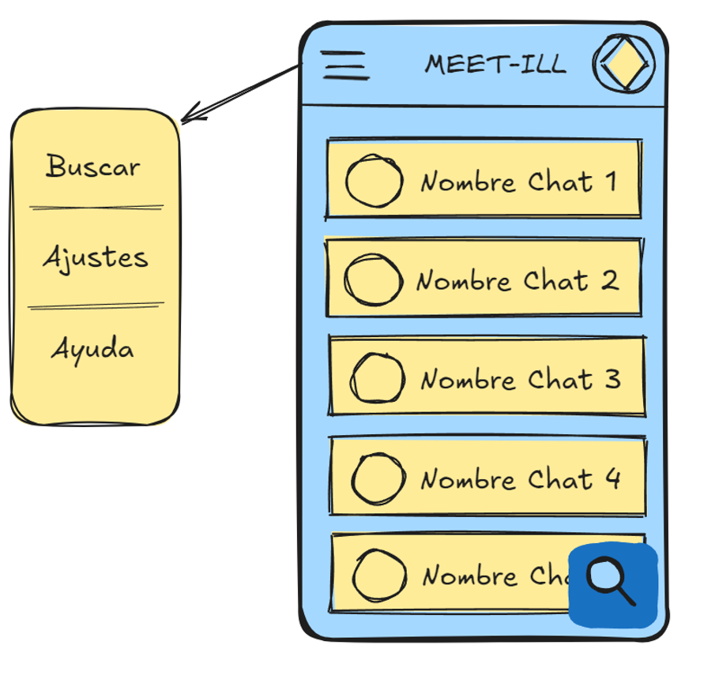

# Meet-ill

Aplicación móvil Android orientada a conectar a personas que conviven con patologías similares. Permite descubrir grupos temáticos, participar en conversaciones grupales y mantener conversaciones privadas con otros usuarios.

## Autores

- Pedro Castro Montes (`uo288120`)
- Javier Monteserín Rodríguez (`uo288524`)
- Mikel González Rodríguez (`uo289630`)

## Estado y alcance

Este repositorio contiene el cliente Android nativo y su integración con Firebase. La aplicación gestiona autenticación, perfiles, pertenencia a grupos, mensajería y solicitudes de nuevos grupos. Los datos remotos y las reglas de acceso dependen de un proyecto Firebase configurado aparte.

## Funcionalidades

- Registro e inicio de sesión mediante correo electrónico y contraseña con Firebase Authentication.
- Perfil con alias, nombre, patologías seleccionadas e imagen. La imagen se serializa en Base64 y se guarda como campo del usuario en Firestore.
- Vista de los grupos a los que pertenece el usuario y catálogo de grupos disponibles.
- Filtros de grupos sugeridos según las patologías del perfil, grupos a los que ya se unió el usuario y catálogo completo.
- Unión a grupos y salida de grupos, con actualización de la pertenencia del usuario y de los participantes del grupo.
- Chat grupal, lista de chats privados recientes y chat privado.
- Solicitud de creación de un grupo y vista de solicitudes agregadas por patología.
- Pantalla de perfil, edición de perfil y cierre de sesión.

## Tecnologías

| Área | Tecnología |
| --- | --- |
| Plataforma | Android, Kotlin |
| Interfaz | XML, View Binding, Material Components, RecyclerView |
| Navegación | AndroidX Navigation y navegación inferior |
| Estado de interfaz | ViewModel y LiveData |
| Operaciones asíncronas | Kotlin Coroutines y `Task.await()` |
| Identidad | Firebase Authentication |
| Datos de aplicación | Cloud Firestore |
| Mensajería en tiempo real | Firebase Realtime Database |
| Almacenamiento de archivos | Firebase Storage está incluido como dependencia; las imágenes de perfil actuales se guardan como Base64 en Firestore |
| Imágenes | Coil y CircleImageView |
| Diagnóstico | Firebase Crashlytics |
| Construcción | Gradle Kotlin DSL, Android Gradle Plugin 8.6.0 |

La aplicación utiliza `compileSdk`, `targetSdk` y `minSdk` 34. El bytecode Kotlin/JVM y la compatibilidad de compilación Java están configurados en Java 8.

## Estructura del proyecto

```text
.
├── app/
│   ├── src/main/java/com/example/meet_ill/
│   │   ├── adapters/       # Adaptadores de RecyclerView
│   │   ├── data/           # Resultado y modelos del flujo de autenticación
│   │   ├── data_classes/   # Modelos Parcelable del dominio
│   │   ├── repos/          # Acceso a Firestore y Realtime Database
│   │   ├── util/           # Tipos de usuario y acceso compartido a Auth
│   │   ├── viewmodels/     # Estado y lógica de presentación
│   │   └── *.kt            # Activities y Fragments
│   ├── src/main/res/       # Layouts, navegación, temas, cadenas e imágenes
│   ├── src/test/           # Pruebas unitarias locales
│   ├── src/androidTest/    # Pruebas instrumentadas
│   └── google-services.json
├── gradle/                 # Catálogo de versiones y Gradle Wrapper
├── DocImages/              # Recursos de documentación
└── README.md
```

### Capas y responsabilidades

- **Activities y Fragments:** `LoginActivity` y `SignupActivity` controlan el acceso; `MainActivity` aloja la navegación principal; `HomeFragment`, `BuscarGruposMainFragment`, `ChatRecientesFragment` y `AjustesMainFragment` implementan las secciones principales. `ProfileActivity` y `ProfileEditActivity` muestran y modifican el perfil. `ChatActivity`, `PrivateChatActivity`, `GroupInfoActivity` y `VisualizarSolicitudesActivity` cubren conversaciones, miembros e información complementaria.
- **ViewModels:** encapsulan el estado observable y las operaciones de login, alta, perfil, grupos de inicio y búsqueda. `ViewModelFactory` proporciona `UserRepository` a los ViewModels de perfil.
- **Repositorios:** `UserRepository` consulta usuarios y actualiza perfiles; `GroupRepository` consulta grupos, participantes y mensajes de grupo; `ChatRepository` resuelve conversaciones privadas y mensajes; `SolicitudesRepository` crea solicitudes y agrupa sus conteos.
- **Adaptadores:** `GroupAdapter`, `FilteredGroupAdapter`, `RecentChatAdapter`, `ChatAdapter`, `ParticipantesAdapter` y `SolicitudesAdapter` presentan los elementos en listas y gestionan eventos de las filas.
- **Modelos:** `User`, `Grupo`, `Message`, `ChatRecientes`, `Contacto`, `InfoUser` y `ConjuntoSolicitudes` representan entidades o datos transferidos entre pantallas. Varios modelos implementan `Parcelable` para su paso mediante `Intent` o argumentos.
- **Recursos:** los layouts XML definen las pantallas y filas; `res/navigation/navegacion.xml` declara los destinos principales; `res/menu/menu_navegacion.xml` define las opciones de navegación inferior.

## Navegación de la aplicación

La actividad inicial declarada en el manifiesto es `LoginActivity`. Tras autenticarse o registrarse se abre `MainActivity`, que presenta cuatro destinos inferiores:

1. **Grupos:** grupos a los que pertenece el usuario.
2. **Chat privado:** lista de conversaciones privadas recientes.
3. **Buscar grupos:** catálogo con filtros sugeridos, unidos y todos.
4. **Ajustes:** formulario para solicitar grupos, acceso al listado de solicitudes y cierre de sesión.

El acceso al perfil se realiza desde la barra personalizada de `MainActivity`. Desde las listas se abren las actividades de conversación e información de grupo.

## Persistencia y modelo de datos

La implementación usa más de un producto Firebase. Los nombres de colecciones y campos siguientes corresponden al código del cliente; las reglas de seguridad y cualquier dato inicial deben configurarse en Firebase.

### Cloud Firestore

- **`users/{uid}`:** perfil identificado por el UID de Authentication. El código lee y escribe campos como `apodo`, `name`, `email`, `imagenPerfil`, `patologias`, `groupsIds` y `user-type`. El alta crea inicialmente `apodo`, `name`, `email`, `user-type` y `groupsIds`.
- **`grupos/{groupId}`:** grupo con campos como `nombre`, `urlImagen` y `participantes`. `urlImagen` se resuelve como nombre de recurso drawable local. Los mensajes y las operaciones de pertenencia están implementados en distintos caminos de almacenamiento, descritos a continuación.
- **`solicitudes/{requestId}`:** solicitud con `idUsuario`, `enfermedad`, `fecha` y `usuario`. La pantalla de administración agrupa las solicitudes por enfermedad.
- **`chats/{chatId}`:** documento de conversación privada con lista ordenada `participantes`. El repositorio también contiene operaciones de mensajes en `mensajesChat`.

### Firebase Realtime Database

Las pantallas de chat leen y envían mensajes en tiempo real bajo las rutas `grupos/{groupId}/messages` y `chats/{chatId}/messages`. Cada mensaje en estas rutas contiene `sender`, `text` y `timeSent`. El código de actividad registra listeners para reflejar nuevos mensajes.

El proyecto incluye además métodos de repositorio que leen mensajes en Firestore bajo `grupos/{groupId}/mensajesGrupo` y `chats/{chatId}/mensajesChat`, con los campos `sender`, `texto` y `timeSent`. Por ello, la integración actual contiene ambos esquemas para mensajes; el backend debe estar provisionado conforme al flujo que utilice cada pantalla.

## Configuración del entorno

### Requisitos

- Android Studio compatible con Android Gradle Plugin 8.6.0.
- JDK compatible con Gradle y Android Gradle Plugin usados por el proyecto.
- Android SDK Platform 34 y herramientas de compilación correspondientes.
- Dispositivo o emulador con Android 14 (API 34) o superior, dado el `minSdk` actual.
- Proyecto Firebase con Authentication, Cloud Firestore y Realtime Database habilitados.

### Firebase

El módulo `app` aplica los plugins de Google Services y Crashlytics y contiene `app/google-services.json`. Para usar otro proyecto Firebase, registra en Firebase una aplicación Android con el identificador `com.example.meet_ill` y coloca su archivo de configuración en `app/google-services.json`. Comprueba que Authentication, Firestore y Realtime Database estén habilitados y que las reglas permitan las operaciones necesarias a usuarios autenticados.

Las pantallas de chat usan la instancia de Realtime Database `https://meet-ill-default-rtdb.europe-west1.firebasedatabase.app`. Si cambias de proyecto o región, actualiza esa referencia en los puntos de inicialización de la base de datos.

Para probar roles administrativos, crea y configura la cuenta y el documento de usuario correspondientes en el proyecto Firebase de desarrollo. El repositorio no define una cuenta administrativa ni credenciales de prueba verificables.

## Compilación

Desde la raíz del repositorio:

```powershell
.\gradlew.bat assembleDebug
```

En macOS o Linux:

```bash
./gradlew assembleDebug
```

El APK de depuración se genera en `app/build/outputs/apk/debug/`. Para generar una versión de distribución, configura la firma de Android y revisa `app/build.gradle.kts`; el tipo `release` actual no habilita minificación.

## Pruebas

El proyecto contiene una prueba unitaria de ejemplo (`ExampleUnitTest`) y una prueba instrumentada de ejemplo (`ExampleInstrumentedTest`). No constituyen una cobertura funcional de autenticación, persistencia, filtros o mensajería.

Comandos disponibles:

```bash
./gradlew test
./gradlew connectedAndroidTest
```

En Windows, ejecuta los mismos objetivos con `gradlew.bat`.

## Consideraciones técnicas

- El nivel mínimo de API 34 limita la instalación a Android 14 o versiones posteriores.
- La mensajería mezcla operaciones Firestore y Realtime Database entre repositorios y actividades. Al configurar o evolucionar el backend, mantén coherentes rutas, campos y reglas de ambos esquemas.
- Las imágenes de perfil se codifican como Base64 en el documento Firestore del usuario. Esto aumenta el tamaño de los documentos frente a almacenar archivos en Firebase Storage y guardar sus URL.
- Las imágenes de los grupos se seleccionan por nombre entre los recursos `drawable` incluidos en la aplicación; no se descargan desde la URL de un servidor.
- Las reglas de Firestore y Realtime Database, las credenciales de firma y la creación inicial de grupos no se definen en este repositorio.

## Diseño inicial

El directorio `DocImages` contiene el prototipo visual inicial de la aplicación:


